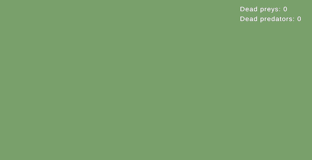

<h1>Zoo World <a href="README.md"></a></h1>


Симуляция зоопарка с видом сверху. Животные появляются на поле, двигаются, сталкиваются, хищники едят добычу.

<p align="center">
  
</p>

## Запуск

- Unity 6000.6.5f1, URP.
- Пакеты: Extenject, R3, uGUI с TextMeshPro, Unity Test Framework.
- Откройте сцену `Assets/_Project/Scenes/Main.unity` и нажмите Play.
- Тесты - в Test Runner, вкладка EditMode.

## Структура проекта

Файлы проекта находятся в `Assets/_Project`, сторонние плагины - в `Assets/Plugins`.

| Папка | Что внутри |
|---|---|
| **Сцена** | |
| `Scenes` | главная сцена `Main.unity` |
| **Ассеты** | |
| `Content/Animals/Definitions` | виды животных: Frog, Snake, Mouse. В папке вида его карточка, движение, префабы и материалы |
| `Content/Animals/Interactions` | правила столкновений: кто кого ест, кто разлетается |
| `Content/Animals/Spawn` | какие животные появляются и как часто |
| `Content/Animals/View` | общий префаб животного и надпись "Tasty!" |
| `Content/Environment` | границы экрана и земля |
| `Content/Rendering` | настройки URP |
| **Код** | |
| `Scripts/Animals` | логика животных: модель, движение, состояния, столкновения, спавн, отображение |
| `Scripts/UI` | интерфейс: счетчик погибшей добычи и хищников |
| `Scripts/Shared` | общие контракты: границы экрана и случайные числа |
| `Scripts/App` | запуск игры: сборка зависимостей и игровой цикл |
| `Scripts/Tests/EditMode` | тесты по разделам ТЗ |

В сцене: `SceneContext` с `GameInstaller`, камера, `UI` со счетчиком, `Environment` со светом и землей и пустой `Animals`, куда спавнятся животные.

Внутри `Scripts/Animals`:

```text
Scripts/Animals/
  Editor/         инспектор карточки и ее проверка
  Interactions/   очередь столкновений, таблица правил, стратегии Eat, Bounce, Duel
  Lifecycle/      пул, фабрика, популяция живых животных, спавн
  Movement/       направление и движение, стратегии Jump и Linear
  States/         Moving, Idle, Knockback, Dead
  View/           отображение на сцене: префаб, тело, модель, надпись
```

> **Мышь добавлена сверх ТЗ.** Она собрана из ассетов по шагам из раздела "Как добавить животное".

## Архитектура

### Паттерны

Type Object (карточка вида), Strategy (движение, взаимодействия), State (животное), Factory (животное из карточки), MVP, Object Pool, DI на Extenject, Observer на R3.

### Вид животного

Все животные - это один класс `Animal`. Вид описывает карточка `AnimalDefinition` (ScriptableObject):

```text
Snake.asset
  Id, Spawn Weight
  Role        Prey или Predator
  View Prefab SnakeView.prefab (вариант AnimalView.prefab с моделью змеи)
  Movement    SnakeMovement.asset (Linear: скорость, интервал поворота)
```

Все, что дизайнер настраивает у вида, лежит в карточке. Компоненты префаба хранят только ссылки на свои части.

### MVP

```text
Животное:  Animal       -> AnimalPresenter       -> IAnimalView
UI:        DeathCounter -> DeathCounterPresenter -> IDeathCounterView
```

Модель отдает read-only свойства и события R3, презентер подписывается и вызывает вью. Вью пассивные: `AnimalView` раздает команды своим компонентам - телу, модели и надписи.

### Состояния

У каждого животного своя машина состояний: `Moving`, `Idle` (пауза между прыжками), `Knockback` (после удара), `Dead`. Переходы решает `AnimalStateMachine`, `Animal` отдает ей команды.

### Движение

`IMovementStrategy` создается из своего конфига. Конфиг выбирается в карточке, поэтому змея и мышь используют одну `LinearMovementStrategy` с разными настройками. Лягушка перед прыжком поворачивается, проверяет точку приземления и прыгает так, чтобы не вылететь за экран.

### Взаимодействия

Правила столкновений лежат в `Content/Animals/Interactions/InteractionTable.asset`. Срабатывает первая подходящая строка.

```text
Predator x Prey     -> Eat     добыча умирает, хищник показывает "Tasty!"
Prey     x Prey     -> Bounce  обоих отбрасывает друг от друга
Predator x Predator -> Duel    побеждает тот, кто появился раньше
```

Столкновения складываются в очередь и разбираются в фиксированном шаге. Каждая пара обрабатывается один раз, мертвое животное сразу выходит из физики.

### Сборки

Одна сборка на фичу: `Shared`, `Animals`, `UI`, `App`, плюс редактор и тесты. Логика `internal`, публичны контракты и то, на что ссылаются сцена и инспектор: компоненты префаба и ассеты. `Shared` не зависит от движка: там лежат границы экрана и случайные числа, а реализации для Unity живут в `App`.

### Тесты

Тесты разбиты по разделам ТЗ: `GameplayTests`, `FoodChainTests`, `AnimalsTests`, `UITests`, `ExtensibilityTests`.

## Как добавить животное

1. Create > Zoo World > Animal в папке `Content/Animals/Definitions/<Имя>/`.
2. Сделать вариант `AnimalView.prefab`, положить внутрь модель и указать ее в `AnimalVisualComponent`.
3. Create > Zoo World > Movement > Jump или Linear и указать как Movement.
4. Заполнить Role, Spawn Weight и View Prefab.
5. Добавить карточку в `Content/Animals/Spawn/SpawnTable.asset`.

Новый тип движения добавляется классом стратегии и ее конфигом. Новое взаимодействие - классом стратегии, конфигом и строкой в таблице.

## Спасибо

Спасибо, что уделили время проекту. Буду рад обратной связи и вопросам.
