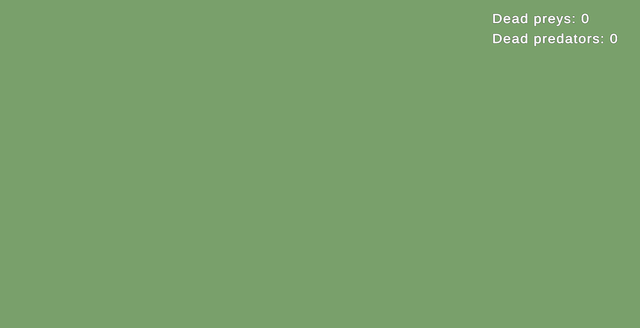

<h1>Zoo World <a href="README.RU.md"></a></h1>


A top-down zoo simulation. Animals appear on the field, move around and collide, predators eat prey.

<p align="center">
  
</p>

## Getting started

- Unity 6000.6.5f1, URP.
- Packages: Extenject, R3, uGUI with TextMeshPro, Unity Test Framework.
- Open `Assets/_Project/Scenes/Main.unity` and press Play.
- Tests are in the Test Runner, EditMode tab.

## Project structure

Project files are in `Assets/_Project`, third-party plugins are in `Assets/Plugins`.

| Folder | Contents |
|---|---|
| **Scene** | |
| `Scenes` | main scene `Main.unity` |
| **Assets** | |
| `Content/Animals/Definitions` | animal species: Frog, Snake, Mouse. Each species folder holds its card, movement, prefabs and materials |
| `Content/Animals/Interactions` | collision rules: who eats whom, who bounces off |
| `Content/Animals/Spawn` | which animals appear and how often |
| `Content/Animals/View` | shared animal prefab and the "Tasty!" label |
| `Content/Environment` | screen bounds and ground |
| `Content/Rendering` | URP settings |
| **Code** | |
| `Scripts/Animals` | animal logic: model, movement, states, collisions, spawn, view |
| `Scripts/UI` | interface: dead prey and predator counter |
| `Scripts/Shared` | shared contracts: screen bounds and random numbers |
| `Scripts/App` | game startup: dependency setup and game loop |
| `Scripts/Tests/EditMode` | tests by task section |

Scene: `SceneContext` with `GameInstaller`, the camera, `UI` with the counter, `Environment` with light and ground, and an empty `Animals` object where animals are spawned.

Inside `Scripts/Animals`:

```text
Scripts/Animals/
  Editor/         card inspector and validation
  Interactions/   collision queue, rule table, Eat, Bounce and Duel strategies
  Lifecycle/      pool, factory, population of living animals, spawn
  Movement/       direction and movement, Jump and Linear strategies
  States/         Moving, Idle, Knockback, Dead
  View/           scene representation: prefab, body, model, label
```

> **The mouse is an extra species beyond the task.** It is built from assets following the steps in "Adding an animal".

## Architecture

### Patterns

Type Object (species card), Strategy (movement, interactions), State (animal), Factory (animal from its definition), MVP, Object Pool, DI with Extenject, Observer with R3.

### Species

All animals share one `Animal` class. A species is described by an `AnimalDefinition` card (ScriptableObject):

```text
Snake.asset
  Id, Spawn Weight
  Role        Prey or Predator
  View Prefab SnakeView.prefab (variant of AnimalView.prefab with the snake model)
  Movement    SnakeMovement.asset (Linear: speed, turn interval)
```

Everything a designer tunes for a species is on its card. Prefab components only hold references to their parts.

### MVP

```text
Animal:  Animal       -> AnimalPresenter       -> IAnimalView
UI:      DeathCounter -> DeathCounterPresenter -> IDeathCounterView
```

The model exposes read-only properties and R3 events, the presenter subscribes and calls the view. Views are passive: `AnimalView` passes commands to its components - body, model and label.

### States

Each animal has its own state machine: `Moving`, `Idle` (pause between jumps), `Knockback` (after a hit), `Dead`. `AnimalStateMachine` decides the transitions, `Animal` sends it commands.

### Movement

`IMovementStrategy` is created from its config. The config is chosen on the card, so the snake and the mouse use the same `LinearMovementStrategy` with different settings. Before a jump the frog turns, checks the landing point and jumps so that it stays on screen.

### Interactions

Collision rules are in `Content/Animals/Interactions/InteractionTable.asset`. The first matching row wins.

```text
Predator x Prey     -> Eat     prey dies, predator shows "Tasty!"
Prey     x Prey     -> Bounce  both are pushed apart
Predator x Predator -> Duel    the one that appeared first wins
```

Collisions are queued and resolved in the fixed step. Each pair is handled once, a dead animal leaves physics immediately.

### Assemblies

One assembly per feature: `Shared`, `Animals`, `UI`, `App`, plus editor and tests. Logic is `internal`, public are the contracts and what the scene and the inspector reference: prefab components and assets. `Shared` has no engine references: it holds screen bounds and random numbers, their Unity implementations live in `App`.

### Tests

Tests are grouped by task section: `GameplayTests`, `FoodChainTests`, `AnimalsTests`, `UITests`, `ExtensibilityTests`.

## Adding an animal

1. Create > Zoo World > Animal in `Content/Animals/Definitions/<Name>/`.
2. Create a variant of `AnimalView.prefab`, put the model inside and assign it in `AnimalVisualComponent`.
3. Create > Zoo World > Movement > Jump or Linear and set it as Movement.
4. Fill in Role, Spawn Weight and View Prefab.
5. Add the card to `Content/Animals/Spawn/SpawnTable.asset`.

A new movement type is a strategy class and its config. A new interaction is a strategy class, its config and a row in the table.

## Thank you

Thank you for taking the time to look at the project. Feedback and questions are welcome.
